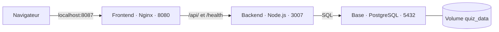

# Quiz App sur ton ordinateur

## Premier lancement

Ouvre Docker Desktop. Place-toi dans le dossier du projet. Si ton fichier `.env` existe déjà, tu peux passer au démarrage Docker.

```bash
cp .env.example .env
```

Dans `.env`, remplis `POSTGRES_PASSWORD`, `ADMIN_PASSWORD` et `JWT_SECRET`. `ADMIN_PASSWORD` est le mot de passe pour l’administration. Tu peux lancer `openssl rand -hex 32` pour générer une valeur pour `POSTGRES_PASSWORD`, puis une autre pour `JWT_SECRET`. Garde ce fichier sur ton ordinateur. Git l’ignore.

```bash
docker compose up --build --wait
docker compose ps
```

Ouvre [le quiz](http://localhost:8087) et saisis `docker` dans le champ « Sujet du quiz ». Pour voir le résultat enregistré, ouvre [l’administration](http://localhost:8087/gestion-quiz) et utilise les valeurs `ADMIN_USERNAME` et `ADMIN_PASSWORD` de ton `.env`.

Tu peux laisser `RESEND_API_KEY` vide. Le score et les réponses sont enregistrés dans PostgreSQL. Pour configurer les emails, suis la section [Tester Resend](#tester-resend).

Pour vérifier que l’API répond, utilise cette commande. La réponse attendue est `{"status":"ok"}`.

```bash
curl -fsS http://localhost:8087/health
```

Si le port 8087 est déjà utilisé, change `QUIZ_PORT` dans `.env` et adapte l’adresse du navigateur. Pour lire les messages de démarrage, utilise `docker compose logs --tail=50`.

## Voir les changements de design automatiquement

Depuis la racine du projet, lance le mode de développement :

```bash
docker compose -f docker-compose.yml -f docker-compose.dev.yml up -d --wait
```

Ouvre [le quiz](http://localhost:8087). Quand tu enregistres une modification du frontend, Vite actualise la page ou son style automatiquement. Le backend et la base restent accessibles pour tester le quiz. La première installation des dépendances peut prendre un peu de temps.

Pour revenir à la version construite avec Nginx :

```bash
docker compose up -d --build --wait
```

## Les trois services



- Node.js construit le **frontend** avec Vite à partir des pages et des questionnaires `questions_*.js`. L’image finale contient les fichiers compilés et Nginx. Nginx sert les pages sur le port 8080 du conteneur et transmet les requêtes de l’API au backend. Docker publie ce port sur `127.0.0.1:8087`.
- Le **backend** reçoit les inscriptions et les résultats, puis les écrit dans PostgreSQL. L’image finale contient Node.js et les dépendances nécessaires au serveur. Les dépendances des deux applications sont installées avec `npm ci` à partir de leurs fichiers `package-lock.json`. Nginx et le backend tournent avec des comptes sans privilèges administrateur.
- **PostgreSQL** initialise les tables avec `database/init.sql` au premier démarrage d’un volume vide. Compose lance le backend dès que PostgreSQL accepte les connexions, puis lance Nginx quand l’API répond. Les services se trouvent par leur nom sur le réseau Compose. Le backend et PostgreSQL gardent leurs ports sur ce réseau. Le pilote `pg` reçoit ses paramètres `PG*` séparément, ce qui évite d’encoder le mot de passe dans une URL. [Documentation de node-postgres](https://node-postgres.com/features/connecting)

## Garder les scores

Le volume `quiz_data` est le dossier de stockage géré par Docker qui garde les utilisateurs, les scores et les réponses. Pour vérifier la persistance, termine un quiz, recrée les conteneurs, puis retrouve le score dans l’administration.

```bash
docker compose up --force-recreate --wait
```

Pour arrêter l’application en gardant le volume, utilise `docker compose down`. Pour la relancer, utilise `docker compose up --wait`.

## Utiliser Neon depuis Docker

Sur une base Neon vide, exécute `database/init.sql` une seule fois dans le SQL Editor de Neon. Le script crée les trois tables et les deux index du quiz. Si les tables et les index existent déjà, passe directement à la configuration. [Schéma SQL](../database/init.sql)

Pour ce projet, le backend Docker a utilisé une connexion directe à Neon avec le certificat TLS vérifié. Après avoir vérifié que les trois tables étaient absentes dans le schéma `public`, le pilote `pg` a exécuté `database/init.sql` entre `BEGIN` et `COMMIT`. PostgreSQL a ainsi créé les tables et les index en une seule opération. Une inscription et un résultat fictifs ont ensuite été enregistrés par l’API et relus dans Neon.

Dans `.env`, renseigne `DATABASE_URL` avec l’URL de connexion affichée dans **Connect** sur Neon. Active **Connection pooling** pour l’URL de l’application. Utilise `sslmode=verify-full` dans l’URL pour faire vérifier le certificat du serveur. [Connexion sécurisée à Neon](https://neon.com/docs/connect/connect-securely)

Relance Docker Compose. Les nouveaux résultats iront dans Neon.

```bash
docker compose up --build --wait
```

Pour retrouver le stockage local, vide `DATABASE_URL` dans `.env` et relance `docker compose up --wait`.

## Tester Resend

Dans `.env`, renseigne une clé Resend avec l’autorisation d’envoyer des emails et mets `FROM_EMAIL=onboarding@resend.dev` pour un essai. Lance `docker compose up --wait` pour charger la configuration.

Le quiz utilise automatiquement l’adresse saisie à l’inscription comme destinataire (`to`). Avec l’expéditeur de test, saisis l’adresse de ton compte Resend pour recevoir le résultat. Tu peux aussi saisir `delivered@resend.dev` pour simuler une livraison dans Resend. Pour envoyer à d’autres adresses, vérifie un domaine dans Resend et utilise un expéditeur de ce domaine. [Restrictions de l’expéditeur de test](https://resend.com/docs/knowledge-base/403-error-resend-dev-domain), [adresses de simulation](https://resend.com/docs/knowledge-base/what-email-addresses-to-use-for-testing)
