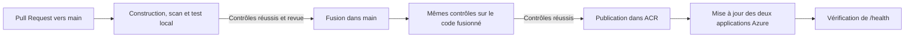

# GitHub Actions et Azure

Une pipeline est une suite d’étapes automatiques. GitHub Actions les regroupe en **jobs**. La **CI** construit et teste le quiz quand tu proposes une modification. La **CD** publie les images validées et met à jour le quiz sur Azure quand le code arrive sur `main`. [Fichier du workflow](../.github/workflows/github-actions.yml)

## Ce que fait le workflow



### Sur une Pull Request vers `main`

Une **Pull Request (PR)** propose d’ajouter les changements de ta branche à `main`. Le job **Build et scan Trivy** se lance quand tu ouvres la PR ou que tu lui ajoutes des commits. [Événement `pull_request`](https://docs.github.com/en/actions/reference/workflows-and-actions/events-that-trigger-workflows#pull_request)

1. Docker Compose construit trois images sur la machine de GitHub Actions. Il prépare le frontend, le backend et un PostgreSQL de test.
2. `scripts/scan-images.sh` lance Trivy sur les trois images. Trivy cherche des failles connues. Une alerte `CRITICAL` fait échouer le job. [Rapport de scan](../preuves/J2/rapport-trivy.md)
3. Si le scan réussit, Docker Compose démarre les trois services. Le test appelle `/health`, charge la page d’administration, crée une inscription et enregistre un résultat dans PostgreSQL. GitHub arrête ensuite les conteneurs et supprime le volume de test.

La PR s’arrête aux contrôles. La règle de protection de `main` contrôle ensuite si elle peut être fusionnée.

### Après la fusion dans `main`

1. La fusion envoie le code sur `main`, ce qui déclenche une nouvelle exécution. Le job relance les mêmes contrôles sur le code fusionné, puis archive les images validées du frontend et du backend.
2. Le job **Publier et déployer sur Azure** récupère l’archive et se connecte à Azure via OIDC. Il vérifie que son commit est toujours le dernier de `main` avant de charger les images Docker. Si `main` a avancé, il saute la mise en ligne de cette version.
3. `scripts/deploy.sh` publie les deux images dans ACR avec le **SHA Git** complet comme tag. Il récupère leur **digest**, l’identifiant de leur contenu exact, et indique à Azure Container Apps quelles images lancer. Il met aussi à jour les réglages du backend et l’adresse interne utilisée par Nginx. [Script de déploiement](../scripts/deploy.sh)
4. Le script attend que les dernières révisions des deux applications soient prêtes. Il vérifie que `/health` répond `{"status":"ok"}` en passant par l’adresse publique du quiz.

Par exemple, si tu modifies le texte d’une question dans `questions_docker.js`, ouvre une PR vers `main` de ton fork. Après validation et fusion, la nouvelle image du frontend contient la question modifiée. Retrouve-la en choisissant le sujet `docker` sur le quiz en ligne.

### Mettre le contrôle sur main

Dans le fork du groupe, ouvre une Pull Request vers `main`. Une fois le premier job visible, exige une Pull Request et le contrôle **Build et scan Trivy** dans les règles de protection de `main`. La revue se fait dans le fork du groupe. [Procédure détaillée](04-pipeline-cicd.md) · [Preuve du blocage de la fusion](../preuves/J6/livraison-github.md#j6-a--ce-que-github-exige-pour-la-fusion)

## Préparer Azure une fois

Le projet du groupe utilise Terraform pour préparer Azure. Si les ressources existent déjà, récupère les sorties `deployment_variables` et `github_login_variables` de `terraform/infra` et utilise-les dans GitHub. La procédure Azure CLI plus bas sert à reproduire le jalon J3 dans un groupe de test dédié. [Relier GitHub Actions à Terraform](12-terraform-azure.md#5-relier-github-actions) · [Preuve du test Azure CLI](../preuves/J3/creation-cli-acr.md)

### Vérifier les régions autorisées

Dans Azure Cloud Shell ou dans un terminal connecté à Azure, vérifie l’abonnement et affiche les régions autorisées par ses règles. [Documentation des règles Azure CLI](https://learn.microsoft.com/en-us/cli/azure/policy/assignment#az-policy-assignment-list)

```bash
az account show --query '{abonnement:name, etat:state}' --output table
az policy assignment list --filter 'atScope()' \
  --query "[?parameters.allowedLocations || parameters.listOfAllowedLocations].{Regle:displayName,Regions:parameters.allowedLocations.value || parameters.listOfAllowedLocations.value}" \
  --output json
```

Si la liste est vide, sélectionne ton abonnement dans Azure Policy. Ouvre la règle **Allowed resource deployment regions** et regarde **Parameters → Allowed locations**. [Affectations Azure Policy](https://portal.azure.com/#view/Microsoft_Azure_Policy/PolicyMenuBlade/~/Assignments)

Pour vérifier les profils Container Apps d’une région, remplace `belgiumcentral` par le code de la région que tu veux utiliser dans `az containerapp env workload-profile list-supported --location belgiumcentral --output table`. [Profils Container Apps](https://learn.microsoft.com/en-us/azure/container-apps/workload-profiles-manage-cli#list-available-workload-profiles)

### Accès à Azure avec OIDC

**OIDC** permet à GitHub Actions de prouver à Azure qu’il lance le déploiement depuis `main` du fork autorisé. Azure vérifie le **sujet OIDC**, qui indique le dépôt et la branche, puis donne un accès temporaire au job. Utilise le sujet exact de ton fork. Selon ses réglages, il peut ressembler à l’un de ces exemples. [Connexion GitHub à Azure](https://docs.github.com/en/actions/how-tos/secure-your-work/security-harden-deployments/oidc-in-azure) · [Formats du sujet OIDC](https://docs.github.com/en/actions/reference/security/oidc#immutable-subject-claims)

- Format avec les noms `repo:PROPRIETAIRE/DEPOT:ref:refs/heads/main`
- Format avec les noms et identifiants `repo:PROPRIETAIRE@ID_PROPRIETAIRE/DEPOT@ID_DEPOT:ref:refs/heads/main`

Si la règle OIDC est déjà en place sur le déploiement du groupe, affiche le sujet qu’Azure attend avec cette commande. [Référence Azure CLI](https://learn.microsoft.com/en-us/cli/azure/identity/federated-credential#az-identity-federated-credential-show)

```bash
az identity federated-credential show --name github-main \
  --identity-name quizapp-lucas-mohamed-github-deploy \
  --resource-group rg-quizapp-lucas-mohamed --query subject --output tsv
```

| Identité Azure | Ce qu’elle peut faire |
| --- | --- |
| Identité de déploiement, utilisée par GitHub Actions | `AcrPush` et `Reader` pour publier et lire les informations du registre. `Container Apps Contributor` pour gérer les applications. `Managed Identity Operator` pour leur attribuer l’identité de lecture. |
| Identité de lecture, utilisée par les deux applications | `AcrPull` pour télécharger leurs images depuis le registre. |

### Continuer la préparation

Pour le J3 avec Azure CLI, choisis un nom de groupe dédié au test et un nom de registre disponible mondialement. Remplace `REGION_AUTORISEE` par le code de la région autorisée que tu as choisie. Le mode `rbac` du registre permet d’utiliser les rôles `AcrPull` et `AcrPush`. [Rôles ACR](https://learn.microsoft.com/en-us/azure/container-registry/container-registry-rbac-abac-repository-permissions)

```bash
az extension add --name containerapp --upgrade

export AZURE_RESOURCE_GROUP=rg-quiz-app-j3
export ACR_NAME=quizappremplacecenom
export AZURE_CONTAINERAPPS_ENVIRONMENT=quiz-env
export AZURE_ACR_PULL_IDENTITY=quiz-acr-pull
region=REGION_AUTORISEE
deploy_identity=quiz-github-deploy

if [ "$(az group exists --name "$AZURE_RESOURCE_GROUP" --output json)" = false ]; then
  az group create --name "$AZURE_RESOURCE_GROUP" --location "$region"
fi
az acr create --name "$ACR_NAME" --resource-group "$AZURE_RESOURCE_GROUP" \
  --location "$region" --sku Basic --role-assignment-mode rbac
az acr config authentication-as-arm update --registry "$ACR_NAME" --status enabled
az containerapp env create --name "$AZURE_CONTAINERAPPS_ENVIRONMENT" \
  --resource-group "$AZURE_RESOURCE_GROUP" --location "$region" \
  --logs-destination none --enable-workload-profiles true
```

Si Azure demande d’enregistrer un fournisseur de ressources, enregistre le fournisseur indiqué dans l’abonnement, puis relance la commande. Pour relier les ressources de test à GitHub Actions, crée ensuite les deux identités et attribue leurs droits.

```bash
for identity in "$AZURE_ACR_PULL_IDENTITY" "$deploy_identity"; do
  if ! az identity show --name "$identity" --resource-group "$AZURE_RESOURCE_GROUP" --output none 2>/dev/null; then
    az identity create --name "$identity" --resource-group "$AZURE_RESOURCE_GROUP" --location "$region"
  fi
done

group_id=$(az group show --name "$AZURE_RESOURCE_GROUP" --query id --output tsv)
registry_id=$(az acr show --name "$ACR_NAME" --resource-group "$AZURE_RESOURCE_GROUP" --query id --output tsv)
pull_id=$(az identity show --name "$AZURE_ACR_PULL_IDENTITY" --resource-group "$AZURE_RESOURCE_GROUP" --query id --output tsv)
pull_principal=$(az identity show --ids "$pull_id" --query principalId --output tsv)
deploy_principal=$(az identity show --name "$deploy_identity" --resource-group "$AZURE_RESOURCE_GROUP" --query principalId --output tsv)

az role assignment create --assignee-object-id "$pull_principal" \
  --assignee-principal-type ServicePrincipal --role AcrPull --scope "$registry_id"
az role assignment create --assignee-object-id "$deploy_principal" \
  --assignee-principal-type ServicePrincipal --role AcrPush --scope "$registry_id"
az role assignment create --assignee-object-id "$deploy_principal" \
  --assignee-principal-type ServicePrincipal --role Reader --scope "$registry_id"
az role assignment create --assignee-object-id "$deploy_principal" \
  --assignee-principal-type ServicePrincipal --role 'Container Apps Contributor' --scope "$group_id"
az role assignment create --assignee-object-id "$deploy_principal" \
  --assignee-principal-type ServicePrincipal --role 'Managed Identity Operator' --scope "$pull_id"
```

Renseigne le sujet exact de `main` de ton fork, puis crée la règle de confiance et affiche le `clientId` pour GitHub. [Formats du sujet OIDC](#accès-à-azure-avec-oidc)

```bash
oidc_subject='repo:PROPRIETAIRE@ID_PROPRIETAIRE/DEPOT@ID_DEPOT:ref:refs/heads/main'
az identity federated-credential create --name github-main --identity-name "$deploy_identity" \
  --resource-group "$AZURE_RESOURCE_GROUP" \
  --issuer https://token.actions.githubusercontent.com \
  --subject "$oidc_subject" \
  --audiences api://AzureADTokenExchange
az identity show --resource-group "$AZURE_RESOURCE_GROUP" --name "$deploy_identity" \
  --query clientId --output tsv
```

## Renseigner GitHub avant la fusion

Dans l’onglet **Actions** du fork, active GitHub Actions si GitHub te le demande. Ouvre ensuite **Settings → Secrets and variables → Actions**, puis l’onglet **Variables**. Avec Terraform, copie les valeurs des deux sorties `deployment_variables` et `github_login_variables`. Avec Azure CLI, prends les noms et identifiants du groupe que tu as configuré.

| Variable | Valeur à prendre |
| --- | --- |
| `AZURE_CLIENT_ID` | `clientId` de l’identité Azure de déploiement |
| `AZURE_TENANT_ID` | `tenantId` donné par `az account show` |
| `AZURE_SUBSCRIPTION_ID` | `id` de l’abonnement donné par `az account show` |
| `AZURE_RESOURCE_GROUP` | Nom du groupe créé pour le quiz |
| `ACR_NAME` | Nom du registre créé pour le quiz |
| `AZURE_CONTAINERAPPS_ENVIRONMENT` | Nom de l’environnement Container Apps |
| `AZURE_ACR_PULL_IDENTITY` | Nom de l’identité qui a le rôle `AcrPull` |
| `AZURE_FRONTEND_APP` | Nom du frontend, `quizapp-lucas-mohamed` dans le déploiement du groupe ou `quiz-frontend` par défaut dans le script |
| `AZURE_BACKEND_APP` | Nom du backend interne, `quiz-backend` par défaut |

Dans **Secrets**, ajoute `ADMIN_PASSWORD` pour la connexion à l’administration et `JWT_SECRET` pour les jetons de connexion. Ajoute aussi `DATABASE_URL` avec l’URL Neon pour que le backend puisse enregistrer des résultats. Si tu actives l’envoi d’emails, ajoute `RESEND_API_KEY` dans **Secrets** et `FROM_EMAIL` dans **Variables**. `ADMIN_USERNAME` est une variable facultative qui vaut `admin` par défaut.

Si tu as créé le registre, l’environnement et les identités avec Azure CLI, le script crée les applications au premier déploiement. Dans l’installation Terraform, `terraform/apps` crée ces applications avant la première livraison GitHub. [Créer les applications avec Terraform](12-terraform-azure.md#4-créer-les-deux-applications)

## Vérifier une livraison

1. Dans **Actions**, ouvre l’exécution sur `main` qui correspond à ton commit. Vérifie que le job de déploiement a publié les images et affiché les deux révisions prêtes.
2. Ouvre l’URL affichée par le job et vérifie que le quiz charge. Ajoute `/health` à cette URL pour voir si Nginx arrive à joindre l’API. HTTP 200 avec `{"status":"ok"}` confirme que le backend répond.
3. Termine un quiz et retrouve ton score dans l’administration pour vérifier l’écriture et la lecture dans Neon. Pour la soutenance, garde le lien de la PR, le résultat des contrôles et l’exécution sur `main` avec les tags et révisions. [Preuves CI/CD](../preuves/J6/livraison-github.md) · [Preuve Neon](../preuves/J5/persistance-neon.md)

| Si tu vois… | Vérifie… |
| --- | --- |
| Le scan Trivy échoue | Dans **Build et scan Trivy**, cherche le nom de l’image et le détail des alertes critiques ou de l’erreur de scan. |
| La connexion Azure échoue | Les trois identifiants `AZURE_*_ID` et le sujet OIDC exact de `main` du fork. |
| Une révision reste en attente | L’image dans ACR, les droits `AcrPull` et les [logs du backend](12-terraform-azure.md#voir-les-logs-du-backend). |
| `/health` répond et les résultats échouent | `DATABASE_URL`, la connexion à Neon et les tables créées par `database/init.sql`. |

## Nettoyer un groupe créé avec Azure CLI

Depuis la racine du dépôt, vérifie d’abord le contenu du groupe de ressources dédié au quiz. Lance ensuite la suppression avec `--apply` pour ce groupe précis.

```bash
scripts/destroy.sh NOM_DU_GROUPE
scripts/destroy.sh NOM_DU_GROUPE --apply
```

Pour les ressources suivies par Terraform, utilise [les commandes du guide Terraform](12-terraform-azure.md#supprimer-les-ressources-du-quiz). [Test du nettoyage Azure CLI](../preuves/J3/creation-cli-acr.md)
