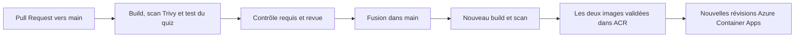

# GitHub Actions et Azure

## Ce que fait le workflow



Le job **Build et scan Trivy** construit le frontend, le backend et PostgreSQL pour Linux AMD64. Trivy renvoie le code 1 s’il détecte une alerte `CRITICAL`. Le job doit réussir avant la fusion. Le test lance aussi le quiz avec une base PostgreSQL de test et vérifie qu’une inscription et un résultat passent par Nginx. [Rapport avant et après les corrections](../preuves/J2/rapport-trivy.md)

Sur `main`, le job suivant recharge l’archive Docker créée après le scan. Il publie ces mêmes images frontend et backend dans Azure Container Registry (ACR) avec le SHA Git complet comme tag. Azure Container Apps reçoit le digest de chaque image, son identifiant de contenu. Le backend se connecte à Neon avec l’URL conservée dans un secret Azure.

### Mettre le contrôle sur main

Dans le fork du groupe, ouvre une Pull Request vers `main`. Une fois le premier job visible, exige une Pull Request et le contrôle **Build et scan Trivy** dans les règles de protection de `main`. La revue se fait dans le fork du groupe. [Consignes du formateur](04-pipeline-cicd.md)

## Préparer Azure une fois

Connecte-toi à Azure CLI et vérifie l’abonnement et la région autorisée. Les commandes ci-dessous créent un groupe dédié au quiz. Choisis un nom de registre disponible avant de les lancer. [Guide des identités et de la connexion à ACR](https://learn.microsoft.com/en-us/azure/container-apps/managed-identity-image-pull)

```bash
az login
az account show --query '{abonnement:name, etat:state}' --output table
az extension add --name containerapp --upgrade

export AZURE_RESOURCE_GROUP=rg-quiz-app
export ACR_NAME=quizappremplacecenom
export AZURE_CONTAINERAPPS_ENVIRONMENT=quiz-env
export AZURE_ACR_PULL_IDENTITY=quiz-acr-pull
region=francecentral
deploy_identity=quiz-github-deploy

az group create --name "$AZURE_RESOURCE_GROUP" --location "$region"
az acr create --name "$ACR_NAME" --resource-group "$AZURE_RESOURCE_GROUP" \
  --sku Basic --role-assignment-mode rbac
az acr config authentication-as-arm update --registry "$ACR_NAME" --status enabled
az containerapp env create --name "$AZURE_CONTAINERAPPS_ENVIRONMENT" \
  --resource-group "$AZURE_RESOURCE_GROUP" --location "$region" --logs-destination none
```

Si Azure demande d’enregistrer un fournisseur de ressources, enregistre le fournisseur indiqué par l’erreur dans l’abonnement, puis relance la commande. L’identité du pipeline publie et déploie. L’identité des Container Apps sert à lire les images dans ACR.

```bash
for identity in "$AZURE_ACR_PULL_IDENTITY" "$deploy_identity"; do
  az identity create --name "$identity" --resource-group "$AZURE_RESOURCE_GROUP"
done

group_id=$(az group show --name "$AZURE_RESOURCE_GROUP" --query id --output tsv)
registry_id=$(az acr show --name "$ACR_NAME" --resource-group "$AZURE_RESOURCE_GROUP" --query id --output tsv)
pull_id=$(az identity show --name "$AZURE_ACR_PULL_IDENTITY" --resource-group "$AZURE_RESOURCE_GROUP" --query id --output tsv)
pull_principal=$(az identity show --ids "$pull_id" --query principalId --output tsv)
deploy_principal=$(az identity show --name "$deploy_identity" --resource-group "$AZURE_RESOURCE_GROUP" --query principalId --output tsv)

az role assignment create --assignee-object-id "$pull_principal" \
  --assignee-principal-type ServicePrincipal --role AcrPull --scope "$registry_id"
az role assignment create --assignee-object-id "$deploy_principal" \
  --assignee-principal-type ServicePrincipal --role AcrPush --scope "$registry_id"
az role assignment create --assignee-object-id "$deploy_principal" \
  --assignee-principal-type ServicePrincipal --role Reader --scope "$registry_id"
az role assignment create --assignee-object-id "$deploy_principal" \
  --assignee-principal-type ServicePrincipal --role 'Container Apps Contributor' --scope "$group_id"
az role assignment create --assignee-object-id "$deploy_principal" \
  --assignee-principal-type ServicePrincipal --role 'Managed Identity Operator' --scope "$pull_id"
```

Ajoute à l’identité de déploiement la règle OIDC qui autorise GitHub Actions sur `main` de ton fork. Le pipeline obtient alors un jeton Azure temporaire. Le sujet ci-dessous inclut les identifiants GitHub du propriétaire et du dépôt, comme le demande le format OIDC de ce fork. [Format du sujet OIDC](https://docs.github.com/en/actions/reference/security/oidc#immutable-subject-claims)

```bash
az identity federated-credential create --name github-main --identity-name "$deploy_identity" \
  --resource-group "$AZURE_RESOURCE_GROUP" \
  --issuer https://token.actions.githubusercontent.com \
  --subject 'repo:LuBoys@97968626/eval-quiz-app@1461168391:ref:refs/heads/main' \
  --audiences api://AzureADTokenExchange
```

## Renseigner GitHub avant la fusion

Dans **Settings → Secrets and variables → Actions** sur le fork, ajoute les variables suivantes.

| Variable | Valeur à prendre |
| --- | --- |
| `AZURE_CLIENT_ID` | `clientId` de l’identité Azure `quiz-github-deploy` |
| `AZURE_TENANT_ID` | `tenantId` donné par `az account show` |
| `AZURE_SUBSCRIPTION_ID` | `id` de l’abonnement donné par `az account show` |
| `AZURE_RESOURCE_GROUP` | Nom du groupe créé pour le quiz |
| `ACR_NAME` | Nom du registre créé pour le quiz |
| `AZURE_CONTAINERAPPS_ENVIRONMENT` | Nom de l’environnement Container Apps |
| `AZURE_ACR_PULL_IDENTITY` | Nom de l’identité qui a le rôle `AcrPull` |

Dans l’onglet **Secrets**, ajoute `ADMIN_PASSWORD`, `JWT_SECRET` et `DATABASE_URL`. `DATABASE_URL` est l’URL de Neon utilisée par le backend. L’envoi d’emails est facultatif. Pour l’activer, ajoute aussi `RESEND_API_KEY` dans **Secrets** et `FROM_EMAIL` dans **Variables**. Le compte admin utilise `admin` par défaut. Les variables `ADMIN_USERNAME`, `AZURE_FRONTEND_APP` et `AZURE_BACKEND_APP` permettent de choisir d’autres noms.

Au premier déploiement, le script crée le backend interne sur le port 3007 et le frontend public sur le port 8080. Le frontend appelle le backend en HTTPS à l’intérieur du même environnement. Les fusions suivantes mettent à jour leurs images. Le job vérifie les révisions et teste `/health` à l’adresse publique du quiz. [Script de déploiement](../scripts/deploy.sh) · [Réseau dans Azure Container Apps](https://learn.microsoft.com/en-us/azure/container-apps/connect-apps)

Pour la soutenance, garde le lien de la Pull Request, l’exécution du scan, puis l’exécution sur `main` avec les tags ACR et les révisions Azure. Vérifie un score enregistré dans l’administration pour démontrer en plus la connexion à Neon.
