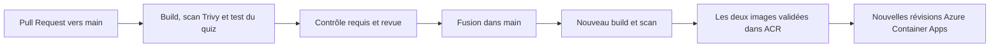

# GitHub Actions et Azure

Le déploiement Terraform `quizapp-lucas-mohamed` fournit au workflow les noms des ressources Azure par les sorties `deployment_variables` et `github_login_variables`. Les commandes Azure CLI plus bas servent au parcours du jalon J3. [Guide Terraform](12-terraform-azure.md)

## Ce que fait le workflow



Le job **Build et scan Trivy** construit le frontend, le backend et PostgreSQL pour Linux AMD64. Trivy renvoie le code 1 s’il détecte une alerte `CRITICAL`. Le job doit réussir avant la fusion. Le test lance aussi le quiz avec une base PostgreSQL de test et vérifie qu’une inscription et un résultat passent par Nginx. [Rapport avant et après les corrections](../preuves/J2/rapport-trivy.md)

Sur `main`, le job suivant recharge l’archive Docker créée après le scan. Il publie ces mêmes images frontend et backend dans Azure Container Registry (ACR) avec le SHA Git complet comme tag. Azure Container Apps reçoit le digest de chaque image, son identifiant de contenu. Le backend se connecte à Neon avec l’URL conservée dans un secret Azure.

### Mettre le contrôle sur main

Dans le fork du groupe, ouvre une Pull Request vers `main`. Une fois le premier job visible, exige une Pull Request et le contrôle **Build et scan Trivy** dans les règles de protection de `main`. La revue se fait dans le fork du groupe. [Consignes du formateur](04-pipeline-cicd.md)

## Préparer Azure une fois

### Commandes déjà exécutées

Le 17 novembre 2026, `az account show` a confirmé que l’abonnement **Azure for Students** était actif. Les commandes suivantes ont créé le groupe du quiz, puis l’identité de déploiement. Azure a accepté l’identité en `belgiumcentral` après avoir refusé sa création avec la région par défaut du groupe.

```bash
az group create -n rg-quiz-app -l francecentral -o none
az identity create -g rg-quiz-app -n quiz-github-deploy \
  --location belgiumcentral --query clientId -o tsv
```

L’identifiant affiché par la deuxième commande va dans la variable GitHub `AZURE_CLIENT_ID`. La création de la règle OIDC qui autorise `main` figure plus bas.

### Continuer la préparation

Dans Azure Cloud Shell, vérifie l’abonnement et affiche les régions autorisées par ses règles. [Documentation des règles Azure CLI](https://learn.microsoft.com/en-us/cli/azure/policy/assignment#az-policy-assignment-list)

```bash
az account show --query '{abonnement:name, etat:state}' --output table
az policy assignment list --filter 'atScope()' \
  --query "[?parameters.allowedLocations || parameters.listOfAllowedLocations].{Regle:displayName,Regions:parameters.allowedLocations.value || parameters.listOfAllowedLocations.value}" \
  --output json
```

Si la liste est vide, sélectionne ton abonnement dans Azure Policy. Ouvre la règle **Allowed resource deployment regions** et regarde **Parameters → Allowed locations**. [Affectations Azure Policy](https://portal.azure.com/#view/Microsoft_Azure_Policy/PolicyMenuBlade/~/Assignments)

Remplace `REGION_AUTORISEE` par un code de région autorisé et choisis un nom de registre disponible. Si ton groupe existe déjà, garde-le. Azure permet d’y placer des ressources dans une autre région. Pour vérifier les profils Container Apps d’une région, utilise `az containerapp env workload-profile list-supported --location belgiumcentral --output table` en adaptant le code si besoin. [Régions et groupes de ressources](https://learn.microsoft.com/en-us/azure/azure-resource-manager/management/overview#which-location-should-i-use-for-my-resource-group) · [Profils Container Apps](https://learn.microsoft.com/en-us/azure/container-apps/workload-profiles-manage-cli#list-available-workload-profiles)

```bash
az extension add --name containerapp --upgrade

export AZURE_RESOURCE_GROUP=rg-quiz-app
export ACR_NAME=quizappremplacecenom
export AZURE_CONTAINERAPPS_ENVIRONMENT=quiz-env
export AZURE_ACR_PULL_IDENTITY=quiz-acr-pull
region=REGION_AUTORISEE
deploy_identity=quiz-github-deploy

if [ "$(az group exists --name "$AZURE_RESOURCE_GROUP" --output json)" = false ]; then
  az group create --name "$AZURE_RESOURCE_GROUP" --location "$region"
fi
az acr create --name "$ACR_NAME" --resource-group "$AZURE_RESOURCE_GROUP" \
  --location "$region" --sku Basic --role-assignment-mode rbac
az acr config authentication-as-arm update --registry "$ACR_NAME" --status enabled
az containerapp env create --name "$AZURE_CONTAINERAPPS_ENVIRONMENT" \
  --resource-group "$AZURE_RESOURCE_GROUP" --location "$region" --logs-destination none
```

Si Azure demande d’enregistrer un fournisseur de ressources, enregistre le fournisseur indiqué par l’erreur dans l’abonnement, puis relance la commande. L’identité du pipeline publie et déploie. L’identité des Container Apps sert à lire les images dans ACR.

```bash
for identity in "$AZURE_ACR_PULL_IDENTITY" "$deploy_identity"; do
  if ! az identity show --name "$identity" --resource-group "$AZURE_RESOURCE_GROUP" --output none 2>/dev/null; then
    az identity create --name "$identity" --resource-group "$AZURE_RESOURCE_GROUP" --location "$region"
  fi
done

group_id=$(az group show --name "$AZURE_RESOURCE_GROUP" --query id --output tsv)
registry_id=$(az acr show --name "$ACR_NAME" --resource-group "$AZURE_RESOURCE_GROUP" --query id --output tsv)
pull_id=$(az identity show --name "$AZURE_ACR_PULL_IDENTITY" --resource-group "$AZURE_RESOURCE_GROUP" --query id --output tsv)
pull_principal=$(az identity show --ids "$pull_id" --query principalId --output tsv)
deploy_principal=$(az identity show --name "$deploy_identity" --resource-group "$AZURE_RESOURCE_GROUP" --query principalId --output tsv)

az role assignment create --assignee-object-id "$pull_principal" \
  --assignee-principal-type ServicePrincipal --role AcrPull --scope "$registry_id"
az role assignment create --assignee-object-id "$deploy_principal" \
  --assignee-principal-type ServicePrincipal --role AcrPush --scope "$registry_id"
az role assignment create --assignee-object-id "$deploy_principal" \
  --assignee-principal-type ServicePrincipal --role Reader --scope "$registry_id"
az role assignment create --assignee-object-id "$deploy_principal" \
  --assignee-principal-type ServicePrincipal --role 'Container Apps Contributor' --scope "$group_id"
az role assignment create --assignee-object-id "$deploy_principal" \
  --assignee-principal-type ServicePrincipal --role 'Managed Identity Operator' --scope "$pull_id"
```

Ajoute à l’identité de déploiement la règle OIDC qui autorise GitHub Actions sur `main` de ton fork. Le pipeline obtient alors un jeton Azure temporaire. Le sujet ci-dessous inclut les identifiants GitHub du propriétaire et du dépôt, comme le demande le format OIDC de ce fork. [Format du sujet OIDC](https://docs.github.com/en/actions/reference/security/oidc#immutable-subject-claims)

```bash
az identity federated-credential create --name github-main --identity-name "$deploy_identity" \
  --resource-group "$AZURE_RESOURCE_GROUP" \
  --issuer https://token.actions.githubusercontent.com \
  --subject 'repo:LuBoys@97968626/eval-quiz-app@1461168391:ref:refs/heads/main' \
  --audiences api://AzureADTokenExchange
```

## Renseigner GitHub avant la fusion

Dans **Settings → Secrets and variables → Actions** sur le fork, ajoute les variables suivantes.

| Variable | Valeur à prendre |
| --- | --- |
| `AZURE_CLIENT_ID` | `clientId` de l’identité Azure `quiz-github-deploy` |
| `AZURE_TENANT_ID` | `tenantId` donné par `az account show` |
| `AZURE_SUBSCRIPTION_ID` | `id` de l’abonnement donné par `az account show` |
| `AZURE_RESOURCE_GROUP` | Nom du groupe créé pour le quiz |
| `ACR_NAME` | Nom du registre créé pour le quiz |
| `AZURE_CONTAINERAPPS_ENVIRONMENT` | Nom de l’environnement Container Apps |
| `AZURE_ACR_PULL_IDENTITY` | Nom de l’identité qui a le rôle `AcrPull` |
| `AZURE_FRONTEND_APP` | Nom de la Container App publique |
| `AZURE_BACKEND_APP` | Nom de la Container App interne |

Dans l’onglet **Secrets**, ajoute `ADMIN_PASSWORD`, `JWT_SECRET` et `DATABASE_URL`. `DATABASE_URL` est l’URL de Neon utilisée par le backend. L’envoi d’emails est facultatif. Pour l’activer, ajoute aussi `RESEND_API_KEY` dans **Secrets** et `FROM_EMAIL` dans **Variables**. Le compte admin utilise `admin` par défaut et la variable `ADMIN_USERNAME` permet de choisir un autre identifiant.

Au premier déploiement, le script crée le backend interne sur le port 3007 et le frontend public sur le port 8080. Le frontend appelle le backend en HTTPS à l’intérieur du même environnement. Les fusions suivantes mettent à jour leurs images. Le job vérifie les révisions et teste `/health` à l’adresse publique du quiz. [Script de déploiement](../scripts/deploy.sh) · [Réseau dans Azure Container Apps](https://learn.microsoft.com/en-us/azure/container-apps/connect-apps)

Pour la soutenance, garde le lien de la Pull Request, l’exécution du scan, puis l’exécution sur `main` avec les tags ACR et les révisions Azure. Vérifie un score enregistré dans l’administration pour démontrer en plus la connexion à Neon.
