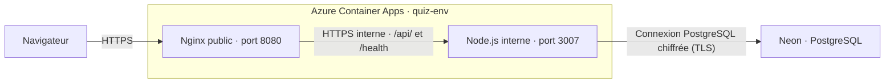

# Architecture de Quiz App sur Azure

**Azure Container Registry (ACR)** stocke nos images Docker. Chaque image contient le programme et ce dont il a besoin pour démarrer. **Azure Container Apps** démarre des conteneurs à partir de ces images pour faire tourner le quiz.

## Où tourne le quiz

| Ressource | Nom dans le projet | À quoi elle sert |
| --- | --- | --- |
| Groupe de ressources Azure | `rg-quizapp-lucas-mohamed` | Rassemble les ressources du quiz dans l’abonnement Azure. |
| Registre d’images (ACR) | `quizapplucasmohamed` | Stocke les images `quiz-frontend` et `quiz-backend`. |
| Environnement Container Apps | `quiz-env` | Accueille les deux applications et leur permet de communiquer. |
| Frontend | `quizapp-lucas-mohamed` | Nginx sert les pages du quiz et reçoit le trafic public. Son conteneur écoute sur le port `8080`. |
| Backend | `quiz-backend` | Node.js traite les inscriptions et les résultats. Son entrée réseau est interne et vise le port `3007`. |
| Base de données | PostgreSQL sur Neon | Garde les inscriptions, les scores et les réponses en dehors des conteneurs Azure. |

Les noms correspondent au déploiement du groupe vérifié en Belgique Centre. Azure fournit au frontend une adresse publique en HTTPS. [Preuve du déploiement](../preuves/J4/deploiement-azure.md) · [Entrées réseau de Container Apps](https://learn.microsoft.com/en-us/azure/container-apps/ingress-overview)

## Le trajet d’une réponse au quiz

1. Tu ouvres le quiz. Nginx envoie la page et le JavaScript au navigateur.
2. Quand tu termines, le navigateur envoie ton score à `/api/results`. Nginx transfère la requête au backend en utilisant son adresse interne `BACKEND_URL`.
3. Le backend enregistre le résultat dans Neon. Il utilise le secret `database-url` d’Azure comme variable `DATABASE_URL`. Si Resend est configuré, le backend lui demande aussi d’envoyer le résultat par email. [Configuration et routes de l’API](08-documentation-technique.md) · [Test de persistance Neon](../preuves/J5/persistance-neon.md)

Sur ton ordinateur, Docker Compose utilise le même trajet jusqu’au backend. Par défaut, le backend parle au conteneur PostgreSQL `db` et Docker conserve les données dans le volume `quiz_data`. [Schéma Docker Compose](10-demarrage-local.md#les-trois-services)

## Images, révisions et réplicas

- Une **révision** est une version déployée d’une application, avec son image et ses réglages de conteneur. Quand la pipeline livre une nouvelle image, Azure prépare une nouvelle révision. Ici, chaque application fonctionne en mode `Single`. Azure bascule le trafic vers sa nouvelle révision quand elle est prête. Neon conserve les scores entre deux livraisons. [Révisions Container Apps](https://learn.microsoft.com/en-us/azure/container-apps/revisions)
- Un **réplica** est une copie du conteneur en cours d’exécution. Le déploiement du groupe en garde au moins un par application, avec un maximum de deux. [Configuration Terraform](12-terraform-azure.md)

Terraform prépare la première installation. GitHub Actions publie ensuite les images dans ACR et met à jour les applications. Les deux applications téléchargent leurs images avec leur identité Azure qui a le droit `AcrPull`. [Pipeline et accès Azure](11-configurer-cicd.md) · [Télécharger une image avec une identité Azure](https://learn.microsoft.com/en-us/azure/container-apps/managed-identity-image-pull)
