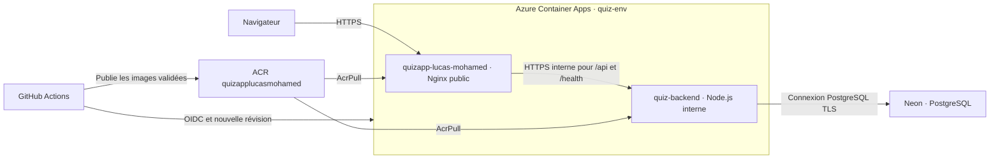

# Architecture de Quiz App sur Azure

- Le frontend écoute sur le port 8080. Nginx sert les fichiers du quiz et transmet `/api` et `/health` au backend à l’intérieur de `quiz-env`. Le backend écoute sur le port 3007.
- Terraform `infra` prépare le registre ACR, l’environnement et les identités. Terraform `apps` crée les applications. Le script Azure CLI livre ensuite les nouvelles images validées par GitHub Actions.
- Le backend lit les secrets de sa Container App. Chaque application garde un réplica prêt, avec un maximum de deux. La mise à jour d’une révision conserve les résultats dans Neon.

[Schéma de Docker Compose](10-demarrage-local.md#les-trois-services) · [Test du déploiement](../preuves/J4/deploiement-azure.md)
