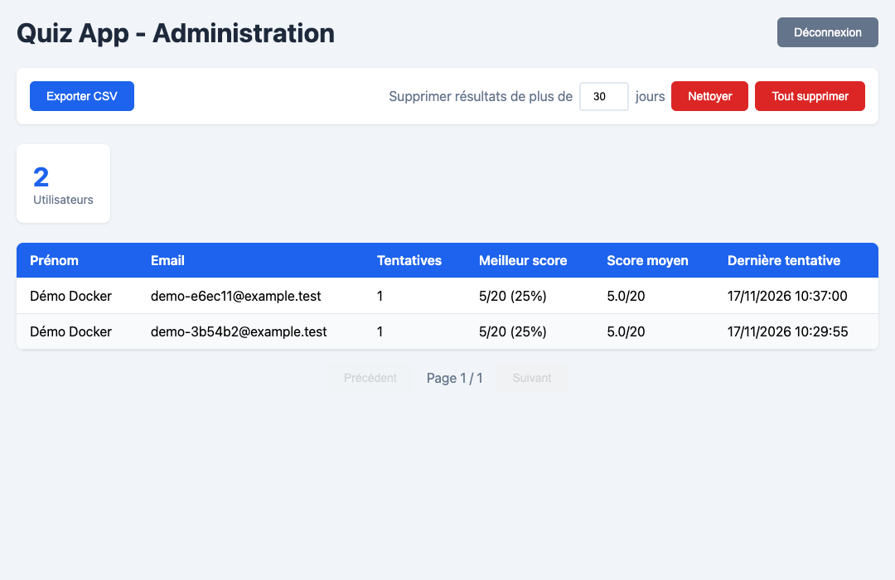

# J1 · Vérification locale du 17 novembre 2026

Vérification sur macOS avec Docker Desktop et Chrome. Deux utilisateurs fictifs ont servi à tester l’inscription, les 20 questions du quiz Docker et l’enregistrement des scores.

```bash
docker compose up --build --wait
curl -fsS -w '\nHTTP %{http_code}\n' http://localhost:8087/health
docker compose up --force-recreate --wait
docker compose ps
```

| Vérification | Résultat observé |
| --- | --- |
| Démarrage avec un volume vide | Le schéma est créé et les trois services deviennent `healthy`. Une inscription et un résultat de test sont enregistrés. |
| Santé derrière Nginx | HTTP 200 et `{"status":"ok"}` |
| Inscription depuis le navigateur | `POST /api/users` renvoie HTTP 201 |
| Fin du quiz | `POST /api/results` renvoie HTTP 201 et la page affiche « Résultats enregistrés ! » |
| Temps écoulé sur une question | Le score et les 20 réponses restent enregistrés. PostgreSQL conserve une réponse vide pour la question dont le temps est écoulé. |
| Après recréation | Les trois conteneurs ont de nouveaux identifiants et sont `healthy`. Le volume `eval-quiz-app_quiz_data` est le même et les deux scores se retrouvent dans l’administration. |

```text
backend-1 | Server running on port 3007
db-1      | PostgreSQL Database directory appears to contain a database; Skipping initialization
db-1      | database system is ready to accept connections
```

## Captures

Fin du quiz avec confirmation d’enregistrement.


Les deux scores de démonstration après recréation des conteneurs.



## Test avant la PR de livraison

Un projet Docker Compose de test nommé `quiz-preuves-j1` a démarré avec le PostgreSQL local. Le frontend a servi la question « Quelle commande Docker lit un Dockerfile pour construire une image ? ». L’API a enregistré vingt réponses, dont une expirée, avec un score fictif de **19/20**. Après `docker compose up --no-build --force-recreate --wait`, les trois services étaient `healthy`, le volume `quiz-preuves-j1_quiz_data` existait et l’administration renvoyait le même score.

Un deuxième essai depuis le formulaire du navigateur a parcouru le quiz Docker jusqu’au bilan. La question modifiée est apparue et le site a affiché **Résultat enregistré.** avec le score fictif de **5/20**.
