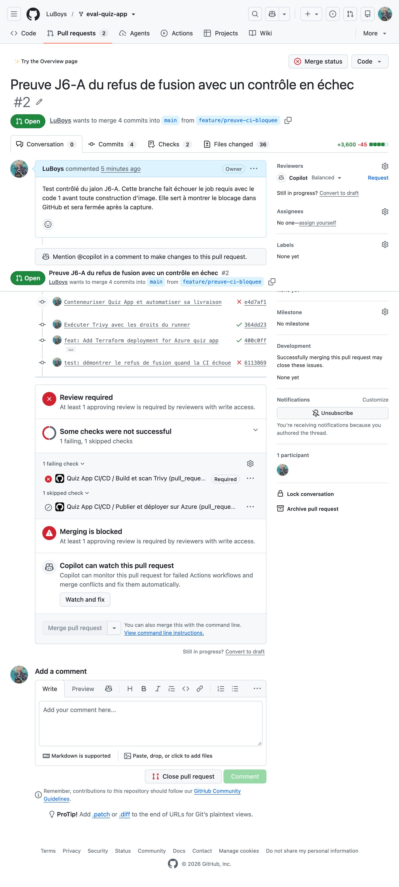

# J6 · Contrôle des PR et livraison sur Azure

Vérification effectuée le 17 novembre 2026 sur `LuBoys/eval-quiz-app`.

## J6-A · Ce que GitHub exige pour la fusion

1. Une règle active cible `main`. Elle exige une PR, une approbation et le job **Build et scan Trivy**. Elle interdit la suppression et le push forcé de la branche. [Règles du fork](https://github.com/LuBoys/eval-quiz-app/rules)
2. Un commit vide créé à partir de `main` a servi à tenter un push normal vers `main`. GitHub l’a refusé avec le code `GH013` et le message `Changes must be made through a pull request`. Le SHA de `main` avant et après était `d567f03abfc4f8a6bf0ef3f14513dead4c89e1eb`.
3. La [PR de test #2](https://github.com/LuBoys/eval-quiz-app/pull/2) a fait sortir volontairement le job requis avec le code 1 avant le build. La page a affiché **Some checks were not successful** et **Merging is blocked**. La PR a été fermée après la capture. [Exécution CI en échec](https://github.com/LuBoys/eval-quiz-app/actions/runs/44101487743)
4. Le test local du [rapport Trivy](../J2/rapport-trivy.md#contrôle-des-images-pour-github-actions-et-azure) montre séparément le code de sortie 1 de Trivy sur une alerte critique.
5. La [PR de livraison #1](https://github.com/LuBoys/eval-quiz-app/pull/1) change le texte de la question Docker en « Quelle commande Docker lit un Dockerfile pour construire une image ? ». Docker Compose a servi la question modifiée et l’API locale a conservé un score fictif après recréation des conteneurs. [Test local](../J1/verification-locale.md)

## J6-B · Ce qui se vérifie après l’approbation et la fusion

1. Dans [Actions sur `main`](https://github.com/LuBoys/eval-quiz-app/actions/workflows/github-actions.yml?query=branch%3Amain), ouvrir le run dont le commit correspond à la fusion.
2. Le job **Build et scan Trivy** construit, scanne et teste les images, puis archive celles du frontend et du backend. Le job Azure les charge après connexion OIDC.
3. Le [script de déploiement](../../scripts/deploy.sh) publie les deux images dans ACR avec le SHA complet du commit, récupère leurs digests et met à jour les apps. Vérifier les révisions prêtes et la réponse de [`/health`](https://quizapp-lucas-mohamed.proudplant-fb1d65e2.belgiumcentral.azurecontainerapps.io/health).
4. Montrer la question modifiée dans le quiz en ligne et relire le score du J5 pour vérifier que la mise à jour a conservé les résultats.
